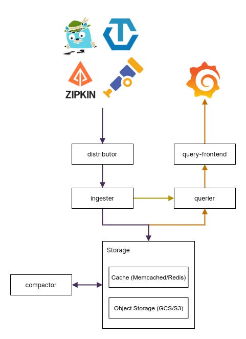
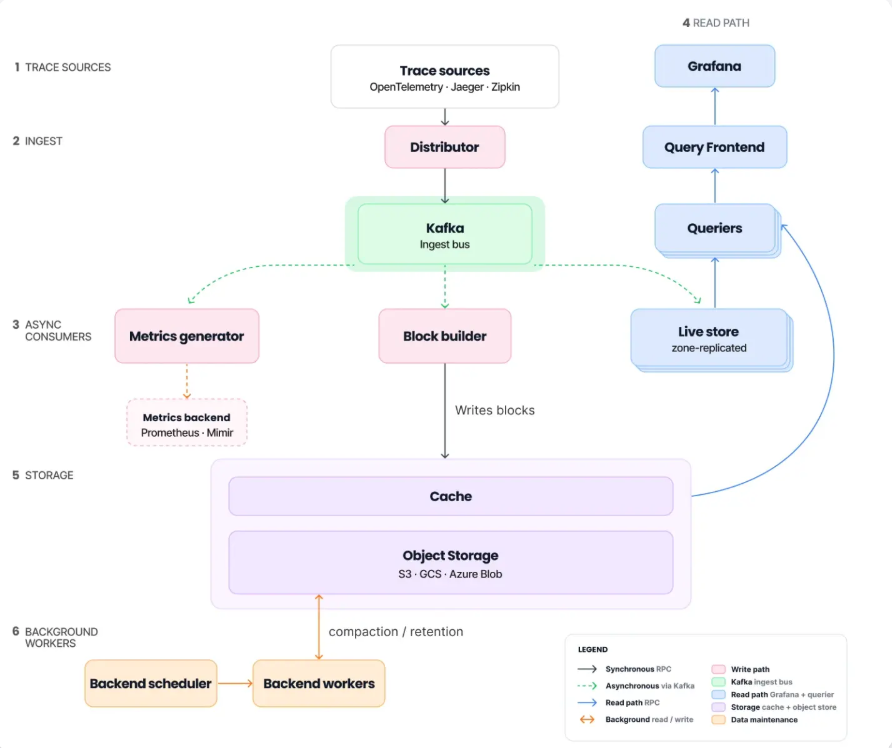

# Tempo 3.0 architecture (vs Tempo 2.x)

Source: Grafana's Tempo 3.0 release blog (June 2026). Items marked *(general knowledge)* are not from the blog.

## 1. Summary

Tempo 3.0 makes the "Project Rhythm" architecture the default. It puts a **Kafka-compatible system** between ingestion and storage, removes **ingesters** and **compactors**, and stores **one copy (RF1)** of trace data instead of three.

|  | Tempo 2.x | Tempo 3.0 |
| --- | --- | --- |
| Write path | Distributor → ingesters (RF3) → object storage | Distributor → Kafka → block-builder → object storage |
| Recent-data reads | Ingesters | Live-store (reads from Kafka) |
| Replication | RF3 (3 to 3.5x storage incl. metrics blocks) | RF1 in object storage; Kafka protects in-flight data |
| Read/write coupling | Shared components | Fully split |
| Compaction | Compactor | Backend scheduler + backend worker |
| TraceQL metrics | Experimental, needs metrics-generator + local-blocks | GA, on by default, no local-blocks |
| Metrics-generator input | Distributor push | Kafka topic |
| Block format | Older formats | vParquet5 |

## 2. Tempo 2.x: how it worked



1. The distributor picked 3 ingesters per trace (hash ring) and sent the same spans to all three.
2. Each ingester buffered the data and flushed its own block to object storage, so the same trace was stored up to 3 times.
3. Compactors merged blocks in the background.
4. The metrics-generator (local-blocks) kept a separate set of blocks, tied to individual generators.

**Problems the blog calls out:**

- Storage was 3 to 3.5x the real data volume.
- If a metrics-generator went down, its TraceQL metrics data became temporarily unavailable.
- Reads and writes shared components. Heavy queries could destabilize ingestion, and large attributes could OOM queriers.

## 3. Tempo 3.0: how it works




**Write path**

1. The distributor writes spans to a Kafka topic, which acts as the durable buffer.
2. Block-builders consume the topic and write one copy of each Parquet block to object storage.

**Read path**

- Live-stores consume the same topic and serve recent traces before blocks reach storage.
- Queriers read live-stores for recent data and object storage for historical data.

**Background work**

- The backend scheduler and backend worker replace compactors. They also run retention, blocklist maintenance and redaction jobs.

**Other components**

- The metrics-generator reads from the same Kafka topic and remote-writes metrics to a backend such as Prometheus or Mimir.
- A cache layer sits in front of object storage, and live-stores are zone-replicated (both from the architecture image).
- Monolithic (single binary) mode needs no Kafka.

## 4. Durability: where RF moved

| Stage | Protected by | Configured in |
| --- | --- | --- |
| Span received, not yet in a block | Kafka replication | Kafka (topic RF, `min.insync.replicas`, producer acks) *(general knowledge)* |
| Block in storage | Object storage durability | Cloud provider / bucket settings |

You now manage replication for traces in Kafka. Use RF3 with `min.insync.replicas=2` and enough brokers across zones *(general knowledge)*. Set retention long enough for block-builders and live-stores to recover from outages.

## 5. Other 3.0 changes

- **TraceQL metrics GA:** comparison operators (`> < >= <= = !=`) are supported. Alerting on TraceQL metrics is still experimental.
- **Metrics-generator:** per-label cardinality limits (`max_cardinality_per_label`), DRAIN-based span-name sanitizer, `include_any` filter policy, and tracestate-based sampling compensation.
- **Redaction:** `tempo-cli redact` rewrites blocks to remove traces by ID.
- **vParquet5:** up to 20 dedicated string columns per scope.
- **TraceQL AST optimization:** repeated conditions are rewritten automatically.
- **MCP server:** can be enabled with a dedicated flag.

## 6. Breaking changes and migration

**Removed:** ingesters, compactors, local-blocks processor, v2 block format, OpenCensus receiver, scalable single binary target.

**Query semantics:** `!=` now means NOT IN and `!~` means MATCH NONE. Review complex TraceQL queries first.

**TraceQL metrics:** old RF3 blocks stay readable for search and trace-by-ID, but TraceQL metrics only read RF1 blocks. Without local-blocks on 2.x, metrics cover only data ingested after the upgrade.

**Config migration:**

```
# monolithic
tempo-cli migrate config old-config.yaml > new-config.yaml

# microservices
tempo-cli migrate config \
  --kafka-address=<KAFKA_BROKER_ADDRESS> \
  --kafka-topic=<YOUR_TOPIC> \
  old-config.yaml > new-config.yaml
```

This removes the `ingester`, `ingester_client` and `compactor` config sections and the local-blocks processor, adds Kafka (microservices only), and disables compaction during parallel migration.
