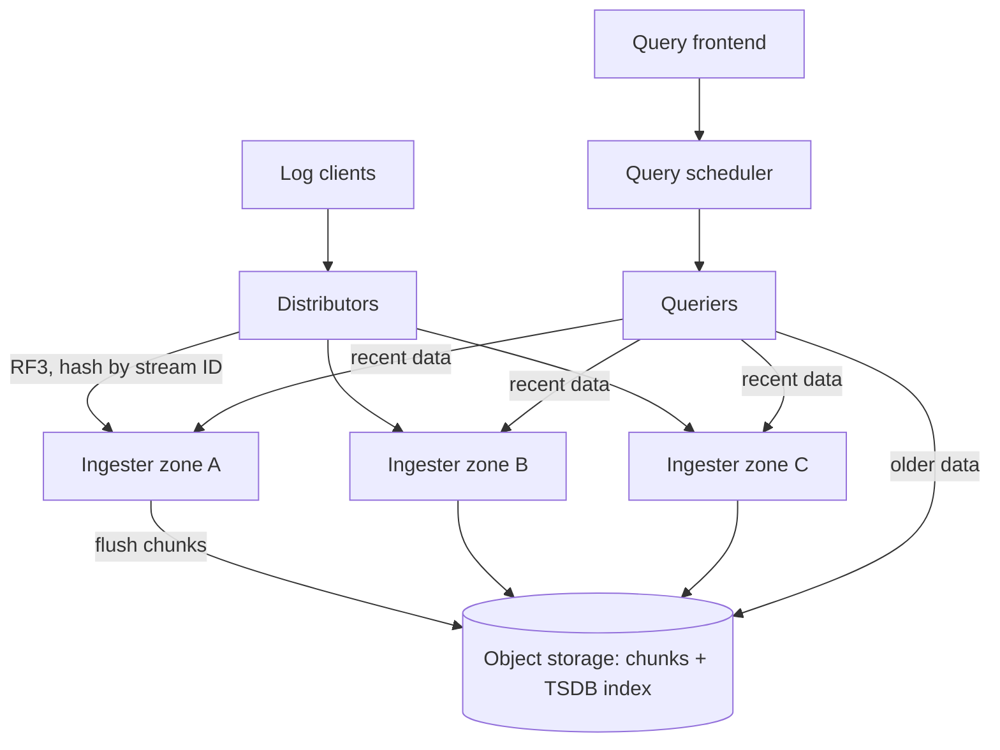
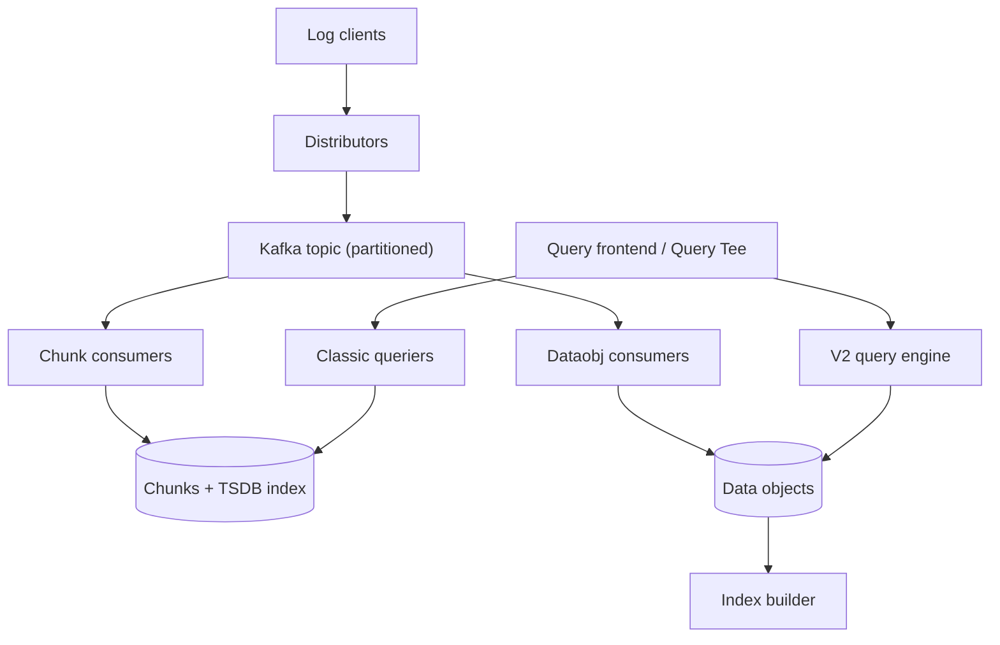

# Loki new architecture (Kafka + data objects) vs classic Loki

## 1. Summary

The new architecture puts **Kafka** between ingestion and storage, moves replication out of the ingesters and into Kafka, adds a **columnar storage format (data objects)**, and adds a **new query engine (V2)**. Chunk-based storage and the classic queriers can run alongside it during migration.

> **Version context:** This architecture was announced at GrafanaCON 2026 (April 2026) as **Loki 4.0**. Early dataobj and Kafka-related components began appearing in the 3.x series (notably 3.7). All experimental flags and config keys should be verified against your installed version.

|  | Classic Loki | New architecture |
| --- | --- | --- |
| Write path | Distributor → ingesters (RF3) → object storage chunks | Distributor → Kafka → consumers → object storage |
| Consumers | Ingesters | Chunk consumer (ingester-like, reads Kafka) and/or dataobj consumer |
| Recent-data reads | Ingesters (in memory) | *(not confirmed)* how hot data is served; talk says reads and writes are separated |
| Replication | RF3, flushed in sync, duplicates removed at query time | Kafka replicates; data is written once |
| Stream distribution | Hash of stream ID | Kafka partitions, can balance by volume |
| Storage format | Chunks (row-based) + TSDB index | Data objects (columnar), chunks optional |
| Query engine | Classic queriers | V2 engine (planner, scheduler, tenant-aware queue) |
| Single binary | No Kafka needed | Still no Kafka needed |
| Distributed mode | No Kafka | Kafka required |
| Cost (vendor claim) | Baseline | Up to 30% lower in Grafana's largest clusters |

## 2. Classic Loki: how it works

1. Distributors fan writes out to ingesters across zones (replication factor 3).
2. Ingesters buffer streams in memory, build chunks, and flush them to object storage.
3. The query frontend splits queries; queriers read recent data from ingesters and older data from object storage.

**Problems the talk calls out:**

- **Read/write coupling.** Ingesters sit on both paths. A heavy query can slow writes, cause 500s, or move ingesters if it touches too many streams.
- **Duplicates from replication.** Ingesters are meant to flush at the same time, but drift out of sync. That writes duplicate chunks to storage, which are deduplicated at query time.
- **Uneven load.** Hashing by stream ID can pile high-throughput streams onto the same ingesters. Auto stream tuning helps but is hard to tune.
- **Chunk format limits.** Chunks are row-based. About 97% of a chunk is log lines. A typical chunk is about 8 MB uncompressed, with only 200 to 300 KB of non-log data (timestamps, structured metadata). Queries read everything, then filter.

## 3. New architecture: how it works

Simplified. The recent-data (hot) read path is not shown because it is not documented in the sources.

**Write path**

1. The distributor writes to a Kafka topic, the durable buffer.
2. Each partition is consumed by one consumer. Writes are acknowledged at Kafka, before consumers.
3. The **chunk consumer** writes chunks like an ingester would. The **dataobj consumer** writes data objects.

**Storage**

- Data objects and chunks live in the same object storage backend, under separate prefixes (`dataobj.storage_bucket_prefix`).
- A dataobj index builder indexes the objects. A dataobj compactor with a planner is in the 3.7.x release notes.

**Read path**

- The classic queriers read chunks. The V2 engine ("Thor" in release notes) reads data objects.
- **Query Tee** (transcribed as "Query T") sits in front of both engines. It routes to chunks, to the new engine, or races both and returns the faster. It exports metrics to compare correctness.

## 4. Why Kafka: benefits and trade-offs

**Benefits (from the talk and InfoQ coverage of GrafanaCON 2026)**

- **Write isolation from reads.** Writes are acknowledged at Kafka, before consumers. Heavy queries no longer slow ingestion or trigger 500s, and ingesters no longer sit on both paths.
- **Replication moves to Kafka.** Logs land in Kafka once and the effective replication factor drops to one. This removes the 3x fan-out to ingesters.
- **No drift duplicates.** In classic Loki, ingesters drift out of sync, so replicas often produce differently named chunks that do not dedupe. Grafana reports that on average each ingested line was stored 2.3 times. That cost shows up in ingestion CPU, memory, network, storage and query-time dedup.
- **Replay.** Consumers track offsets, so data can be reprocessed after a failure or when trying new processing models.
- **Volume-based partitioning.** Kafka partitions can balance by volume instead of hashing stream IDs, which gives more even load across consumers and more predictable capacity planning.
- **Flexibility.** New topics and processing models can be added on the same stream.
- **Cost (vendor claim).** Up to 30% lower in Grafana's largest clusters, even after paying for Kafka.

**Trade-offs**

- Kafka is a big operational dependency. The Loki team acknowledges this directly.
- You pay for brokers, storage and network traffic, and you own replication settings for logs in Kafka.
- Distributed deployments require Kafka. Single-binary mode does not.

## 5. Ingestion capacity vs classic Loki

| Measure | Classic Loki | New architecture |
| --- | --- | --- |
| Ingester-side writes per line | 3 (RF3) | 1 (one Kafka partition) |
| Stored copies per line | About 2.3x average | About 1x |
| Cost at largest clusters | Baseline | Up to 30% lower | 
| Target scale | Scaled by heavy parallelism | Designed for petabyte scale |
| Analytical query cost | Baseline | About 20x less data scanned, 10x faster | 

## 6. Data objects

- **Columnar.** Timestamps, structured metadata and the log line are stored in separate columns, so queries read only what they need.
- **Front-loaded metadata.** Columns, pages, byte ranges and stats are at the front of the file, so a whole object can be skipped quickly.
- **Two round trips.** Read any byte range with one trip for metadata and one parallel trip for the data.
- **Multi-tenant by design.**
- **Compression.** Per-column encoding. Up to 1000x on individual metadata columns (not whole-object size).
- **Sparse columns** via presence bitmaps, **paged access** to cap memory.
- **Not columnar yet:** detected fields (parsed from the log line). They are still parsed at query time.
- **Vendor-reported results:** about 20x less data scanned and 10x faster execution for analytical (business-insight) queries. Not all queries are faster.

## 7. V2 query engine

1. Build a logical plan, then a physical plan and execution strategy.
2. Push predicates down to the scan, so filtering happens early.
3. Split into fine-grained tasks, scheduled through a tenant-aware queue (protects against noisy neighbors).
4. Release notes show a results cache, V2 query limits, and request deduplication being added.

## 8. Durability: where RF moved

| Stage | Protected by | Configured in |
| --- | --- | --- |
| Log received, not yet in an object | Kafka replication | Kafka (topic RF, `min.insync.replicas`, producer acks) *(general knowledge)* |
| Object in storage | Object storage durability | Cloud provider / bucket settings |

You now manage replication for logs in Kafka. A common setup is RF3 with `min.insync.replicas=2` across zones *(general knowledge)*. Retention should be long enough for consumers to recover from outages *(inference)*.

## 9. Migration and deployment modes

- **Run both (how Grafana runs it):** Kafka feeds two consumers (chunks and data objects), with two query engines in front. Existing chunks stay queryable until they age out of retention, then you switch to data objects only.
- **Data objects only:** for a new environment with no old chunks, skip the chunk consumer *(inference, supported by an experimental dev config that sends writes only to the dataobj sink and queries data objects only)*.
- **Cost of running both:** the same logs are stored in both formats, and you run two consumer fleets *(inference)*.
- **Single binary:** no Kafka needed. Grafana states this commitment in the talk.

**Suggested path for existing clusters** 

1. Dual-write, with classic reads.
2. Shadow queries through Query Tee, comparing results and latency.
3. Cut reads over to V2, with chunk writes as rollback.
4. Stop chunk writes and let old chunks expire.

## 10. Config pointers *(experimental, verify per version)*

**Full configuration reference:** [Grafana Loki configuration parameters](https://grafana.com/docs/loki/latest/configure/) — covers every YAML key, defaults, and environment variable expansion. Use `-print-config-stderr` or `-log-config-reverse-order` at runtime to dump the effective config for debugging.

- Root config sections: `kafka_config` and `dataobj` (both marked experimental).
- `dataobj`: `enabled`, `storage_bucket_prefix`, `consumer`, `index`, `metastore`.
- Distributor: `kafka_writes_enabled`, `ingester_writes_enabled`.
- Modules: `dataobj-consumer`, `dataobj-consumer-partition-ring`, `dataobj-index-builder`.
- Flags seen in the dev config: `-dataobj.enabled`, `-dataobj-consumer.ingest-mode` (value `inmemory` seen; the Kafka value was not found), `-dataobj-consumer.topic`.
- The dev config is `cmd/loki/dataobj-inmemory-config.yaml` in the repo.
