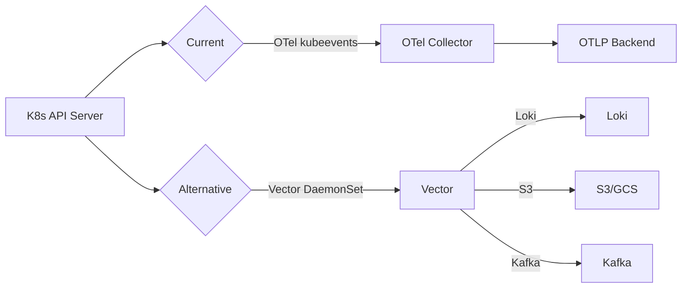

# OTel Collector kubeevents Receiver vs Alternatives

## What OTel Collector kubeevents Does

```yaml
# Typical config
receivers:
  kubeevents:
    auth_type: "serviceAccount"
    resources:
      - events
```

**Capabilities:**
- Watches K8s API for events (normal + warning)
- Converts to OTLP logs format
- Basic filtering (namespace, name, label selector)
- Sends to any OTLP-compatible backend (Tempo, Loki, Jaeger, Datadog, etc.)

---

## Is There Something "Better"? Depends on Your Pain Point

| Pain Point | Better Tool | Why |
|------------|-------------|-----|
| **High cardinality / cost** | **Vector** or **eventrouter** | VRL transforms let you drop/enrich *before* sending; eventrouter routes to cheap storage (S3/GCS) for audit |
| **Need Prometheus metrics from events** | **event-exporter** or **kube-state-metrics** | Native Prometheus metrics (counter/gauge) — cheaper than log-based metrics |
| **Using Loki + need label extraction** | **Promtail** | Native Loki pipeline stages (json, regex, labelmap) — no OTLP→Loki translation loss |
| **Multi-sink routing (Loki + S3 + Kafka)** | **eventrouter** or **Vector** | Single collector fans out to multiple backends with different formats |
| **Custom enrichment (CMDB, GitOps, business context)** | **Custom controller** | Full Go control; OTel processor API is limited |
| **Resource pressure on collector** | **DaemonSet per tool** | Decouples event collection from trace/metric pipeline — OOM in one doesn't kill others |
| **Want CEL/Go templating filters** | **eventrouter** | CEL expressions > OTel's basic label/field selectors |
| **Need event *state* tracking (not just firehose)** | **Custom controller** | OTel only sees events as discrete logs; controllers can track lifecycle |

---

## When OTel kubeevents Is Actually the Right Choice

✅ **Stick with OTel kubeevents if:**
- You already run OTel Collector for traces/metrics
- You want *one* pipeline for everything (logs + traces + metrics)
- Your backend speaks OTLP (Tempo, Loki OTLP, Datadog, New Relic, etc.)
- Team knows OTel config; low desire to manage another tool
- Volume is low-medium (<10k events/sec/cluster)

---

## Migration Path If You Switch



**Vector example (drop-in for most OTel log use cases):**
```yaml
# vector.yaml
sources:
  k8s_events:
    type: kubernetes_events
    node_name: ${NODE_NAME}

transforms:
  enrich:
    type: remap
    inputs: ["k8s_events"]
    source: |
      .k8s_namespace = .kubernetes.namespace_name
      .k8s_pod = .kubernetes.pod_name
      .severity = if .type == "Warning" then "warn" else "info" end

sinks:
  loki:
    type: loki
    inputs: ["enrich"]
    endpoint: "http://loki:3100/loki/api/v1/push"
    encoding: "json"
    labels:
      namespace: "{{ k8s_namespace }}"
      kind: "{{ .kubernetes.kind }}"
```

---

## Verdict

| Scenario | Recommendation |
|----------|----------------|
| **Happy with OTel, low volume, single backend** | Keep OTel kubeevents |
| **Cost optimization / high volume** | Vector (DaemonSet) |
| **Need Prometheus alerts on events** | Add event-exporter alongside OTel |
| **Loki-native, want best label extraction** | Promtail (or Vector → Loki) |
| **Multi-backend, compliance, audit trails** | eventrouter |
| **Complex enrichment / business logic** | Custom controller + OTel for export |

**My take**: If you're *only* collecting events and sending to one OTLP backend — OTel kubeevents is fine. If you feel pain (cost, cardinality, routing, enrichment), **Vector** is the strongest drop-in upgrade.
